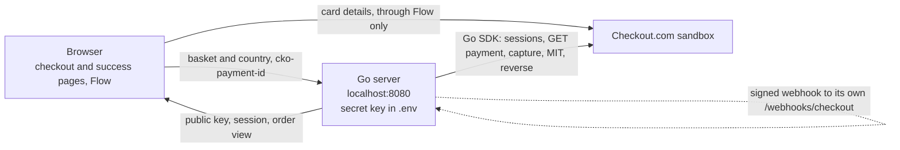

# Panier Box Flow demo

## What it is

A working demo of Panier Box taking payments with Checkout.com Flow, in the sandbox. Marie pays for her first subscription box on a Panier Box checkout page. That first payment is a recurring CIT with 3DS, authorised only. The success page then has a small back office that does what Panier Box's systems would do next: capture the box on dispatch, run next week's renewal as an MIT on the stored card, and void or refund any payment. Cards (with the Cartes Bancaires brand choice) and Google Pay are on every basket. A one-off seasonal box in Portugal also offers MB WAY.

## How it works



* The secret key lives in `.env` and is only read by the Go server. The browser gets the public key from `/api/config`.
* Card details go from Flow straight to Checkout.com and never touch our server, so Panier Box stays on SAQ A.
* The server owns every amount. The browser only picks a basket and a country, and passes back `cko-payment-id` after the payment.
* Payment status always comes from the server's own GET to Checkout.com, never from a webhook body.

Webhooks are simulated. After each action Checkout.com accepts (a capture, a renewal, a reversal, or when the server first sees a new payment), the server waits 800 ms, builds the event Checkout.com would send, signs it with HMAC-SHA256 and posts it to its own `/webhooks/checkout`. The receiver is the same one a real webhook would hit: it checks the signature on the raw body, drops duplicates by event ID, answers 200 and then GETs the payment. We chose this so we didn't have to expose a local machine to the internet through a tunnel. It proves our receiver, not Checkout.com's delivery or retries. In production a Dashboard webhook replaces the simulator and the receiver stays the same.

The live log on the success page shows each call Panier Box makes to Checkout.com, each webhook received, and a line when a GET shows a new status.

## Key decisions

* 3DS stays on the first payment, with `challenge_requested_mandate`, so the MITs that follow are out of SCA scope ([D-003](DECISIONS.md#d-003-flag-the-first-subscription-payment-as-a-recurring-cit-with-3ds), [D-022](DECISIONS.md#d-022-session-request-fields-and-the-mandate-challenge-on-the-recurring-cit)).
* Renewals are authorised close to dispatch, not 10 days ahead, so the authorisation is still valid at capture ([D-004](DECISIONS.md#d-004-make-sure-each-box-has-a-valid-authorisation-on-dispatch-day)).
* The webhook receiver answers 200 at once and does the work after, so slow processing on Panier Box's side doesn't trigger retries ([D-040](DECISIONS.md#d-040-webhook-handler-step-53), [D-044](DECISIONS.md#d-044-facts-from-the-pack-and-the-sandbox-that-the-build-relies-on)).
* Cancelling before dispatch voids the payment. Only a captured payment gets a refund ([D-035](DECISIONS.md#d-035-reverse-on-each-status-card-step-44a)).

## Approach

* Mapped Panier Box's business and use cases first: who starts each payment, CIT or MIT, and when it's authorised and captured.
* Wrote down the assumptions the pack doesn't answer, with the safest default for each.
* Specified the design in PRD.md before writing code.
* Built in small steps, each with its own tests, checked against the sandbox along the way.
* Logged every decision, and every place the docs, API reference and SDK disagreed, in DECISIONS.md.

## Assumptions

* The first subscription payment sets up the series: a recurring CIT with 3DS. Every renewal is an MIT linked to it.
* Scheduled boxes are MITs, handled like weekly renewals.
* One-off pre-orders, like a seasonal box, are CITs.
* Add-ons bought with the first box are part of that payment. Add-ons bought later are their own CIT.
* "Refund on cancel" means void before capture and refund after.
* Panier Box doesn't sell in Portugal yet. The PT option shows what a launch there would look like.

## Run it

You only need Go.

1. Install [Go](https://go.dev/dl/) 1.27 or later.
2. Clone the repo:
   ```
   git clone https://github.com/alfredo-bertorelli-cko/panier-box-flow-demo.git
   cd panier-box-flow-demo
   ```
3. Copy `.env.example` to `.env` and paste in the values I shared with you privately.
4. Start the server: `go run .`
5. Open [http://localhost:8080](http://localhost:8080).

Pay with a test card, then use the back office on the success page: "Dispatch first box", "Run next week's renewal", and Capture or Reverse on each payment card. "Place another order" starts again.

To clear old orders, stop the server and delete `data/orders.json`.

## Test cards

Use the cards on Checkout.com's [test cards page](https://www.checkout.com/docs/developer-resources/testing/test-cards). For the demo, pick:

* an approved card, for the happy path and the renewals
* a co-badged Cartes Bancaires card, to see the brand choice in Flow and the renewal run on the chosen scheme
* a card that declines
* a 3DS card that fails authentication

## Not in this demo

* Renewal retries and declined renewals. A declined renewal shows its card, but nothing retries it.
* Cancelling a subscription. Reverse acts on one payment, it doesn't stop future renewals.
* Card changes, Account Updater, network tokens and 3RI.
* Moving existing subscribers' cards from DimaPay.
* Partial capture, estimated authorisation, Apple Pay and the mobile apps.
* Real webhook delivery from Checkout.com (see above), and a database. Orders live in memory and a JSON file.

## More detail

* [PRD.md](PRD.md): the build spec, flows and API fields.
* [DECISIONS.md](DECISIONS.md): the use case map and every decision, with the reason and the trade-off.

## Tests (optional)

```
go test ./...
go test -race ./...
node --test web/
```

Run them from the repo root. The Go code is in `internal/app`, and the first two cover it: unit, handler and contract tests, with no network and no keys. The last one runs the front-end helper tests and needs [Node](https://nodejs.org/) 18 or later. Node isn't needed to run the demo.
